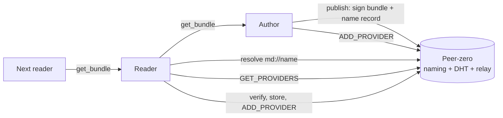
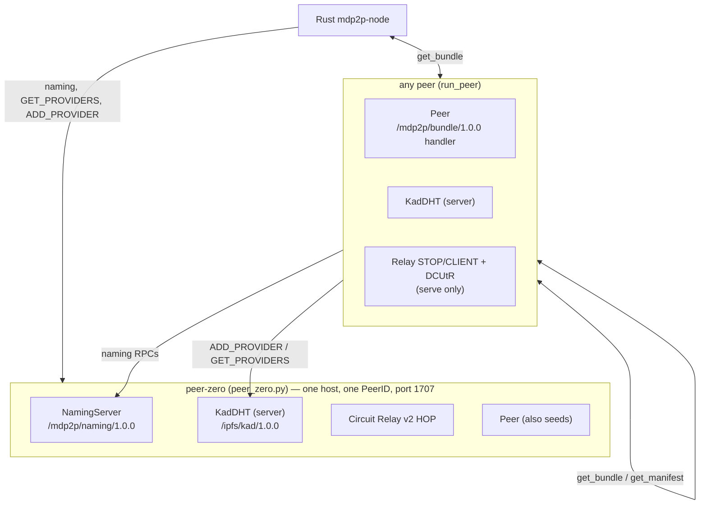
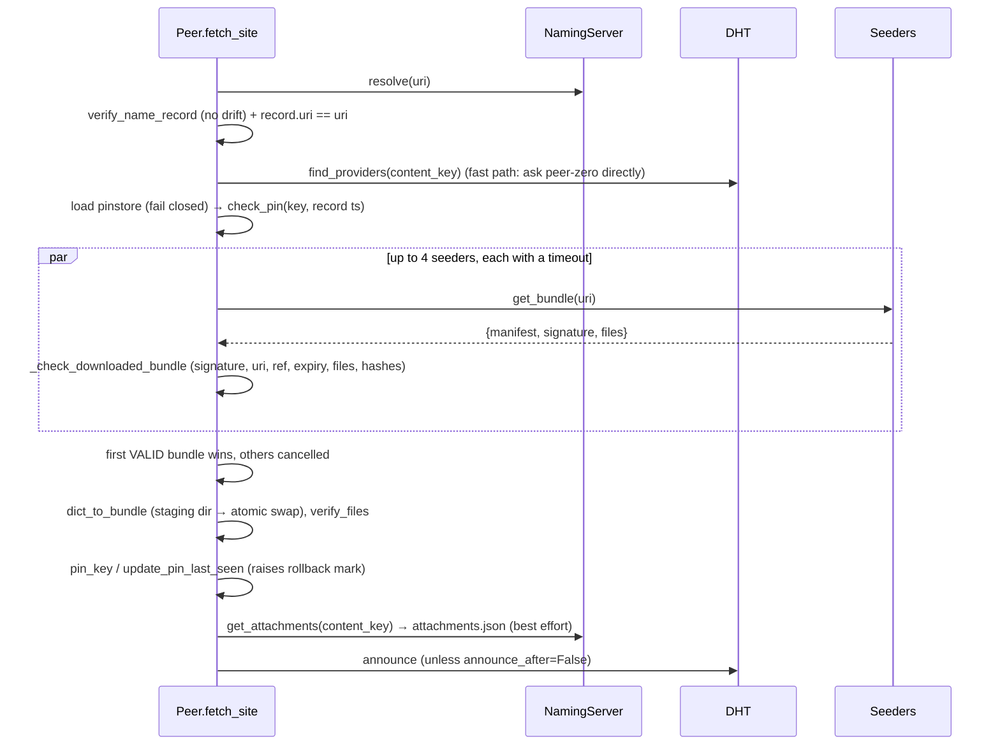
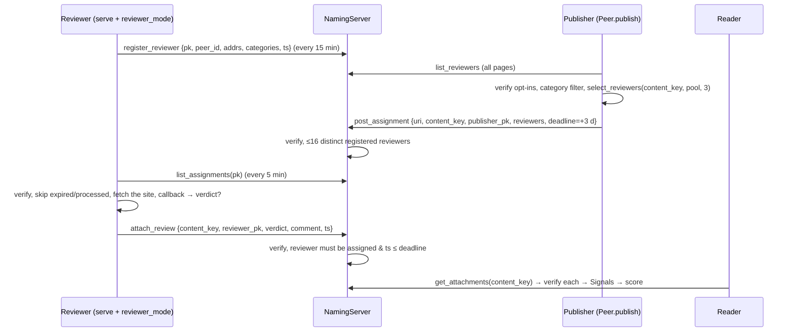

# MDP2P architecture

This is the onboarding guide for the codebase: how it is laid out, what
happens at each step of each process (with the files and functions
involved), and how the non-obvious algorithms work. The wire-level rules
are specified separately in [`SPEC.md`](SPEC.md).

References are `path:line` on `main` at the time of writing. Line numbers
drift, but function names don't, so search for the name if a line has moved.

**Contents**

1. [MDP2P in five minutes](#1-mdp2p-in-five-minutes)
2. [Getting started](#2-getting-started)
3. [Repository map](#3-repository-map)
4. [Identities and identifiers](#4-identities-and-identifiers)
5. [Runtime topology and protocols](#5-runtime-topology-and-protocols)
6. [Layers, bottom to top](#6-layers-bottom-to-top)
7. [Process walkthroughs](#7-process-walkthroughs)
8. [Algorithms in depth](#8-algorithms-in-depth)
9. [On-disk layout](#9-on-disk-layout)
10. [Testing](#10-testing)
11. [Build, CI, release, deploy](#11-build-ci-release-deploy)
12. [Known issues and sharp edges](#12-known-issues-and-sharp-edges)
13. [Recipes: where to start for common changes](#13-recipes-where-to-start-for-common-changes)

---

## 1. MDP2P in five minutes

MDP2P is a web of **Markdown sites addressed as `md://<name>`**, served by
the readers themselves.

- An **author** signs a *bundle*: the `.md` files plus a `manifest.json`
  listing their SHA-256 hashes, signed with an Ed25519 key.
- The author registers `name → (author key, manifest hash)` on a **naming
  server**. The record is signed by the author, so the server cannot forge
  it.
- **Readers** resolve the name, find seeders in a **Kademlia DHT**, download
  the bundle from any of them, and verify it against the name record. They
  then become seeders too ("every visitor becomes a seeder").
- An optional **review** layer works like this: at publish time, a few
  opted-in reviewers are picked deterministically, they attach signed
  verdicts, and each reader turns those verdicts into a show / warn / hide
  decision using *their own* local trust policy.

Two implementations exist:

- **Python (the reference):** the whole system. That is the libp2p peer, the
  naming server / peer-zero, the CLI and Textual TUI, reviews and trust.
- **Rust (`rust/`):** a verification core (`mdp2p-core`, which also compiles
  to WASM) and a libp2p peer (`mdp2p-node`). Both interoperate with the Python
  network. Conformance vectors keep the two in agreement.



## 2. Getting started

### Python

```bash
python3 -m venv .venv && source .venv/bin/activate   # always use a venv (see gotchas)
pip install -e ".[dev,tui]"
pytest tests/ -q                 # ~400 tests, ~30 s (the interop tests also build the Rust node)
python demo.py                   # in-process peer-zero + 3 peers, end to end
```

Gotchas:

- **GMP is required.** py-libp2p pulls in `fastecdsa`, which compiles
  against GMP.
  - Linux: `apt install libgmp-dev build-essential`.
  - macOS:
    ```bash
    brew install gmp
    CFLAGS="-I$(brew --prefix gmp)/include" LDFLAGS="-L$(brew --prefix gmp)/lib" pip install -e ".[dev,tui]"
    ```
- **Never install with Debian/Ubuntu's system pip.** Its patched setuptools
  fails on `varint` and `python-baseconv` with
  `AttributeError: install_layout`. A venv avoids this.
- **Python version:** 3.10 or later is required (`pyproject.toml:9`). CI and
  release builds use 3.11; the Docker image uses 3.13.
- **Run pytest from the repository root.** Tests and modules do
  `sys.path.insert(0, <repo root>)` so they can import the top-level modules
  (`naming`, `pinstore`, `wire`…).
- **Async tests use `trio.run(...)` directly**, called from synchronous test
  functions. There are no pytest-trio markers.

### Rust

```bash
cd rust
cargo test                                   # unit tests + conformance vectors
cargo clippy --all-targets -- -D warnings    # CI is strict
rustup target add wasm32-unknown-unknown
cargo build -p mdp2p-core --target wasm32-unknown-unknown --release
```

`tests/test_rust_interop.py` builds `mdp2p-node` with cargo. Set
`MDP2P_SKIP_RUST_BUILD=1` to use an existing binary instead. Without cargo
and without a binary, those tests are skipped.

### Running a real network locally

```bash
python peer_zero.py --port 1707 --data-dir ./peer_zero_data --listen-host 127.0.0.1
# copy the "Bootstrap" multiaddr it prints, then:
mdp2p setup --author alice --naming /ip4/127.0.0.1/tcp/1707/p2p/<ID>
mdp2p publish --uri blog --site ./my_site
mdp2p fetch --uri blog            # from another data dir / machine
mdp2p tui                         # Textual reader
cargo run -p mdp2p-node -- fetch --naming /ip4/127.0.0.1/tcp/1707/p2p/<ID> blog   # from rust/
```

Use `/ip4/...` multiaddrs: py-libp2p 0.6 cannot dial `/dns4/`
(`mdp2p_client/config.py:21-24`).

## 3. Repository map

```
.
├── SPEC.md                    Wire-level protocol spec (v1) + client acceptance rules
├── ARCHITECTURE.md            This file
├── README.md                  User-facing overview and install
├── AGENTS.md                  Style notes for agents. Partly STALE, see §12
│
├── wire.py                    u32-length-prefixed JSON framing over libp2p streams
├── bundle/                    Pure crypto + data model (no networking)
│   ├── _canonical.py          Canonical JSON (the bytes every signature covers), file hashing
│   ├── crypto.py              Ed25519 key files (0600), base64 raw keys
│   ├── paths.py               validate_uri / validate_path (normalized paths only)
│   ├── manifest.py            create/sign/verify manifest, content_key, manifest_ref, expiry
│   ├── name_records.py        Naming records (build/sign/verify), legacy register proofs
│   └── serialization.py       On-disk bundle I/O, network payload validation, atomic write
├── naming.py                  Naming server (/mdp2p/naming/1.0.0): stores + RPC handlers + client helpers
├── pinstore.py                TOFU key pinning + rollback high-water mark (~/.mdp2p/known_keys.json)
├── peer/                      The libp2p peer
│   ├── peer.py                Peer: publish, announce, find_providers, fetch_site, scoring, review solicitation
│   ├── bundle_protocol.py     /mdp2p/bundle/1.0.0: seeder handler + parallel validated download
│   ├── lifecycle.py           run_peer(): builds host + DHT + relay + Peer; link_peers_dht()
│   ├── host_factory.py        LAN IP detection, Circuit Relay v2 stack, DHT/relay bootstrap
│   └── reviewer_daemon.py     Reviewer opt-in, heartbeat, inbox polling, verdict attach
├── review/                    Review data model (no networking)
│   ├── record.py              Opt-in / assignment / review records (build/sign/verify)
│   ├── selection.py           Deterministic reviewer selection (hash sortition)
│   └── taxonomy.py            30 category slugs, labels in fr/en/zh/ar/hi
├── trust/                     Reader-side moderation (pure, local)
│   ├── signal.py              Signal dataclass (one verified opinion)
│   ├── store.py               ~/.mdp2p/trust.json (per-peer trust counters)
│   ├── policy.py              ~/.mdp2p/policy.json (thresholds, weights, moderators)
│   └── scorer.py              score_content(): weights × severity × decay → show/warn/hide
├── mdp2p_client/              End-user app: `mdp2p` CLI, interactive menu, Textual TUI
│   ├── app.py                 argparse + dispatch (entry point mdp2p_client.app:run)
│   ├── commands.py            One cli_* handler per subcommand
│   ├── *_flow.py              publish / fetch / serve / review orchestration on top of peer/
│   ├── config.py              ~/.mdp2p/config.json, seeded-site scan
│   ├── tui.py                 Textual reader (network actions run the CLI in subprocesses)
│   ├── scoring.py             Offline scoring from cached attachments.json
│   ├── service.py             Install `mdp2p serve` as launchd / systemd --user / schtasks
│   ├── i18n.py + locales/     5 languages, flat key→string JSON
│   └── ui.py, colors.py, formatting.py, permissions.py, interactive.py
├── peer_zero.py               Public node: naming + DHT bootstrap + relay HOP on one host
├── publish.py / fetch.py      Standalone developer CLIs (not packaged)
├── demo.py                    End-to-end demo (peer-zero + alice/bob/charlie)
├── mdp2p_logging.py           Silences noisy py-libp2p loggers
│
├── rust/                      Cargo workspace
│   ├── mdp2p-core/            Pure verification core (canonical JSON, records, bundle checks, pins, selection)
│   └── mdp2p-node/            rust-libp2p peer + `mdp2p-node` CLI (fetch / serve)
├── spec/vectors/*.json        Conformance vectors (generated, see §10)
├── scripts/                   gen_vectors.py (vectors), debug_dial.py (Noise handshake debugging)
├── tests/                     pytest suite (see §10)
├── prototypes/libp2p/         Throwaway feasibility demos from before the libp2p migration
├── packaging/                 PyInstaller spec + entry point for the standalone binary
├── install.sh / install.ps1   One-line binary installers
├── Dockerfile, docker-compose.yml   peer-zero container (BROKEN, see §12)
└── .github/workflows/         ci.yml (tests, vectors, Rust), release.yml (binaries)
```

**Dependency rule.** `bundle/`, `review/` and `trust/` are pure: no
networking, no global state beyond files they are told to read. `wire.py`
and `naming.py` depend on them. `peer/` depends on everything below it.
`mdp2p_client/` sits on top. Keep it that way: the pure layers are what
`mdp2p-core` mirrors and what the vectors pin.

## 4. Identities and identifiers

| What | Kind | Where it lives | Created by |
| --- | --- | --- | --- |
| **Author key** | Ed25519, PEM (0600) | `~/.mdp2p/keys/<author>_<uri>.key` and `.pub` (CLI) | `bundle.generate_keypair` (`bundle/crypto.py:20`), called from `publish_flow.do_publish` |
| **libp2p peer identity** (PeerID) | Ed25519 from a 32-byte seed | `<data_dir>/peer.key` | `naming.load_or_create_peer_seed` (`naming.py:743`), used by `run_peer` |
| **Reviewer key** | Ed25519, PEM | `~/.mdp2p/reviewer/reviewer.key` | `peer.reviewer_daemon.ensure_reviewer_identity` (`peer/reviewer_daemon.py:84`) |

The **site identity is the author key**, not the PeerID. The PeerID only
identifies a transport endpoint, and any peer can seed any site.

Derived identifiers (`bundle/manifest.py:164-182`):

- `content_key(uri, author_pk) = "/mdp2p/" + hex(sha256(f"{uri}:{author_pk}"))`
  - The DHT key that seeders announce, and the key reviews attach to.
  - It does not change across versions, so the swarm survives updates.
- `manifest_ref(manifest) = hex(sha256(canonical_json(manifest)))`
  - The exact manifest a name record commits to.

A **name** (`uri`) is 1 to 255 characters from `[A-Za-z0-9._-]`, starts
with an alphanumeric character, and never contains `..` (`bundle/paths.py:15`).

## 5. Runtime topology and protocols



| Protocol | Framing | Purpose | Implemented in |
| --- | --- | --- | --- |
| `/mdp2p/naming/1.0.0` | u32 BE length + JSON, one request/response per stream | register / resolve / list names, review RPCs | `naming.py` (server + client), `rust/mdp2p-node/src/codec.rs` (client) |
| `/mdp2p/bundle/1.0.0` | same | `get_bundle`, `get_manifest` | `peer/bundle_protocol.py`, `rust/mdp2p-node/src/store.rs` + `node.rs` |
| `/ipfs/kad/1.0.0` | varint length + protobuf | provider records (DHT) | py-libp2p `KadDHT`; Rust: `kad` behaviour, plus a hand-rolled `GET_PROVIDERS` in `codec.rs` |
| Circuit Relay v2 + DCUtR | libp2p | NAT traversal | `peer/host_factory.py` (Python only) |

The libp2p stack on both sides is TCP, Noise, Yamux, Identify and Ping.
Limits:

- Requests are capped at 64 KiB and must arrive within 10 s.
- Naming responses are capped at 1 MiB, bundle responses at 100 MiB.
- Writes are sliced into 32 KiB chunks because Noise rejects any single
  write over 65535 bytes (`wire.py:33`).

## 6. Layers, bottom to top

### 6.1 `wire.py`: framing

- `send_framed_json` (`wire.py:33`) serializes compact, sorted JSON,
  prefixes a 4-byte big-endian length, and writes in `WRITE_CHUNK_SIZE` slices.
- `recv_framed_json` (`wire.py:44`) reads the header, refuses lengths above
  `max_size` *before* reading the payload, then reads exactly that many bytes.
- `read_exact` (`wire.py:21`) uses a `bytearray`, so reassembly stays linear.
- Each protocol picks its own `max_size`.

### 6.2 `bundle/`: data model and crypto

- `create_manifest` (`manifest.py:32`) scans `*.md` recursively and records
  `{path, hash, size}` for each file. It sets `timestamp` and
  `expires_at = now + 30 days`, and `categories` defaults to `["other"]`.
- `sign_manifest` (`manifest.py:96`) adds `public_key`, then signs the
  canonical JSON.
- `verify_manifest` (`:105`) requires that the embedded key equals the
  *trusted* key from the name record, then checks the signature.
- `verify_files` (`:134`) re-hashes the files on disk.
- Name records: `build_name_record` / `sign_name_record` /
  `verify_name_record` (`name_records.py:69-128`).
- `serialization.py`:
  - `bundle_to_dict` (`:37`) reads exact bytes, with no newline translation.
  - `validate_bundle_payload` (`:55`) validates an untrusted payload in memory.
  - `dict_to_bundle` (`:101`) writes it to a staging dir, then
    `_swap_into_place` (`:132`) renames it over the old copy. See §8.4.

### 6.3 `naming.py`: the naming server

The naming server is untrusted: it stores what authors and reviewers sign,
and clients re-verify everything.

- **Stores**: JSON files, rewritten atomically on every accepted write.
  - `NameStore` (`:90`): first key wins a name; timestamps must strictly increase.
  - `ReviewerStore` (`:149`)
  - `AssignmentStore` (`:214`), per-reviewer inboxes
  - `AttachmentStore` (`:291`), one review per (content, reviewer)
- `NamingServer._handle_stream` (`:377`) reads one request (64 KiB, 10 s),
  dispatches on `type` to `_handle_*`, and answers.
- Listings are paginated by `_paginate` (`:612`). Clients merge the pages
  with `_rpc_all_pages` (`:661`).
- With `strict_reviews` (the default), the anti-abuse rules apply. See §7.5.
- Client helpers `client_*` (`:647-740`) each open a stream through `_rpc` (`:634`).

### 6.4 `pinstore.py`: TOFU and rollback

`check_pin(store, uri, pk, record_ts)` (`:46`) returns one of:

- `UNKNOWN`: first visit;
- `MISMATCH`: the key changed;
- `ROLLBACK`: an older record than the stored high-water mark;
- `MATCH`.

`pin_key` and `update_pin_last_seen` raise the mark. Saves are atomic, and a
corrupted file makes `fetch_site` abort (fail closed).

### 6.5 `peer/`: the libp2p peer

- `run_peer(...)` (`lifecycle.py:38`) is the async context manager that
  everything uses: CLI flows, peer-zero, demo, tests. Details in §7.8.
- `Peer` (`peer.py:86`) holds `sites: {uri: site_dir}` and implements:
  - `publish` (`:140`, §7.1);
  - `fetch_site` (`:359`, §7.2);
  - `announce` (`:288`) and `find_providers` (`:314`);
  - `check_for_update` (`:541`): only trusts a manifest signed by the same key;
  - `compute_score` (`:584`), plus review solicitation.
- `bundle_protocol.py`:
  - `make_bundle_handler` (`:139`) is the seeder side.
  - `try_download_from_seeders` (`:52`) is the client side. See §8.3.

### 6.6 `review/` and `trust/`

The data model and scoring are pure. Their lifecycle is in §7.5 and §7.6,
and the formulas are in §8.6 and §8.7.

### 6.7 `mdp2p_client/`: the end-user app

**Entry point.** `pyproject.toml` maps `mdp2p` to `mdp2p_client.app:run`,
which is `trio.run(main)` (`app.py:251`). Without a subcommand, `main`
starts the numbered stdin menu (`interactive.py`). Otherwise it dispatches
to `commands.cli_*`.

| Command | Handler | Goes through |
| --- | --- | --- |
| `setup --author [--naming] [--language] [--reviewer]` | `cli_setup` (`commands.py:162`) | `config.save` |
| `publish --uri --site [--categories]` | `cli_publish` (`:64`) | `publish_flow.do_publish` → `run_peer` → `Peer.publish` |
| `fetch --uri [--naming]` | `cli_fetch` (`:112`) | `fetch_flow.do_fetch` → `run_peer` → `Peer.fetch_site` |
| `serve` | `cli_serve` (`:420`) | `serve_flow.do_serve` (§7.3) |
| `browse` | `cli_browse` (`:53`) | ephemeral host → `naming.client_list` |
| `list`, `status`, `remove`, `pins`, `unpin` | `commands.py` | offline (config, pinstore) |
| `inbox [--json]`, `review --content-key --verdict` | `cli_inbox` (`:367`), `cli_review` (`:404`) | `review_flow` → naming RPCs |
| `reviewer enable/disable/status`, `language` | `commands.py:257-346` | config + reviewer key |
| `service install/uninstall/status` | `cli_service` (`:457`) | `service.py` |
| `tui` | `tui.run` (`tui.py:1236`) | Textual app |

**The TUI** (`tui.py`, Textual):

- It renders seeded sites from disk, with a review badge computed offline
  by `scoring.score_from_cache`.
- **Every network action shells out to the CLI** (`python -m mdp2p_client
  fetch|publish|inbox|review|service …`) from a `@work(thread=True)`
  worker, for example `_run_fetch` (`tui.py:837`) and `_run_publish`
  (`:1091`). This keeps libp2p/trio out of Textual's asyncio loop.
- Results come back through `call_from_thread`.

**Config** is `~/.mdp2p/config.json` (`ClientConfig`, `config.py:31`):

| Field | Default |
| --- | --- |
| `author` | (required) |
| `naming_multiaddr` | `""` |
| `keys_dir` | `~/.mdp2p/keys` |
| `data_dir` | `~/.mdp2p/sites` |
| `port` | `0` |
| `language` | `"fr"` |
| `reviewer_mode` | `False` |
| `reviewer_dir` | `~/.mdp2p/reviewer` |
| `reviewer_categories` | `[]` |

**i18n** (`i18n.py`): `t(key, **kw)` looks the key up in
`locales/<lang>.json` and falls back to the key itself. The five locales
(`fr`, `en`, `zh`, `ar`, `hi`) share 158 keys. Some CLI messages are still
hard-coded English, and the TUI review banner is hard-coded French.

### 6.8 `rust/`: core and node

- **`mdp2p-core`** contains no I/O and mirrors the pure Python layers:
  - `canonical.rs`: canonical JSON, byte-identical to Python's.
  - `records.rs`: signatures, `content_key`, `manifest_ref`, the four
    record verifiers.
  - `paths.rs`: URI and path validation.
  - `fetch.rs`: `check_resolved_record` and `check_downloaded_bundle`, with
    reason codes.
  - `pin.rs`: pin checks.
  - `selection.rs`: reviewer selection.
- **`mdp2p-node`** (rust-libp2p 0.57):
  - `node.rs`: the swarm plus an event loop behind a cloneable `Node`
    handle; commands go through an mpsc channel, replies through oneshots.
  - `codec.rs`: JSON framing and the hand-rolled Kademlia `GET_PROVIDERS`.
  - `fetch.rs`: the download pipeline.
  - `store.rs`: the Python-compatible site store.
  - `pinstore.rs`: a Python-compatible `known_keys.json`.
  - `bin/mdp2p-node.rs`: the `fetch` / `serve` CLI.

## 7. Process walkthroughs

### 7.1 Publish a site (`mdp2p publish --uri blog --site ./my_site`)

```mermaid
sequenceDiagram
  participant CLI as commands.cli_publish
  participant PF as publish_flow.do_publish
  participant P as Peer.publish
  participant NS as NamingServer
  participant DHT as KadDHT (peer-zero)
  CLI->>CLI: validate_categories (review/taxonomy.py)
  CLI->>PF: do_publish(config, uri, site, categories)
  PF->>PF: generate_keypair if ~/.mdp2p/keys/<author>_<uri>.key missing
  PF->>PF: copy *.md into ~/.mdp2p/sites/<author>_<uri>/
  PF->>P: run_peer(...) then peer.publish(...)
  P->>P: version = old.version + 1; create_manifest; sign_manifest; save_bundle
  P->>P: manifest_ref; build_name_record; sign_name_record
  P->>NS: register {record, signature}
  NS->>NS: validate_uri, verify_name_record (±300 s), NameStore.set (same key, newer ts)
  P->>NS: list_reviewers → select → post_assignment (best effort, §7.5)
  P->>DHT: announce: dht.provide(content_key)
```

Step by step, with files:

1. `commands.cli_publish` (`commands.py:64`) validates the categories, then
   calls `publish_flow.do_publish` (`publish_flow.py:39`).
2. `do_publish` creates the author key if it is missing, copies the `.md`
   files into `~/.mdp2p/sites/<author>_<uri>/`, then opens `run_peer` on
   that directory (`publish_flow.py:69`).
3. `Peer.publish` (`peer/peer.py:140`):
   - `validate_uri`.
   - The version is bumped from any existing `manifest.json` (`:170-175`).
   - `create_manifest` → `sign_manifest` → `save_bundle` (`:179-187`).
4. It then builds the name record:
   `compute_manifest_ref` → `build_name_record` → `sign_name_record` →
   `naming.client_register` (`:195-198`). A refusal raises.
5. Server side, `NamingServer._handle_register` (`naming.py:415`) runs
   `validate_uri` and `verify_name_record` (300 s drift), then
   `NameStore.set` (`:129`). That call refuses a different key for an
   existing name and a timestamp that is not strictly greater.
6. `_solicit_reviews` (`peer.py:219`) runs next. It never blocks
   publishing; see §7.5.
7. `self.sites[uri] = dir` and `announce(uri)` (`peer.py:288`) call
   `dht.provide(content_key)`, which sends ADD_PROVIDER to the closest DHT
   peers.
8. Back in the CLI, after a successful publish it offers to install the
   background seeder (`service.offer_interactive`).

`publish.py` at the repository root does the same without the client layer.
It signs the site **in place** and keeps seeding until Ctrl-C.

### 7.2 Fetch a site (`mdp2p fetch --uri blog`)



1. `commands.cli_fetch` → `fetch_flow.do_fetch` (`fetch_flow.py:20`) →
   `run_peer(bootstrap_multiaddrs=[naming])` → `Peer.fetch_site`
   (`peer/peer.py:359`). The CLI passes `announce_after=False`; `serve`
   does the seeding.
2. **Resolve and bind** (`:377-400`): `naming.client_resolve`, then
   `verify_name_record(max_drift=None)`. The record's `uri` **must equal**
   the requested name, otherwise a naming server could answer `bank` with
   `evil`'s record.
3. **Discover** (`:407`): `find_providers` (`:314`) first asks the naming
   peer directly with one GET_PROVIDERS (`_get_providers_from_peer`, the
   "fast path"). If that yields nothing, it falls back to the full
   Kademlia lookup.
4. **Pin** (`:415-440`):
   - An unreadable pinstore aborts the fetch.
   - `check_pin` with the record timestamp. `MISMATCH` (key changed) and
     `ROLLBACK` (older record than already seen) both abort.
5. **Download** (`:450`): `try_download_from_seeders(..., validate=...)`,
   where the validator is `_check_downloaded_bundle` (`peer.py:648`).
   See §8.3 and §8.4.
6. **Store**: `dict_to_bundle` (staging + atomic swap), then `verify_files`
   as a second check on disk (`:464-472`).
7. **Pin update** (`:474-480`), then `_cache_attachments` (`:502`) writes
   `<site>/attachments.json` for offline scoring.
8. `announce` if `announce_after` is set (`:498`).

The standalone `fetch.py` wraps the same call, with `--render` and `--seed`.

### 7.3 Seeding in the background (`mdp2p serve`)

1. `commands.cli_serve` (`commands.py:420`) maps SIGTERM to SIGINT (trio
   only handles SIGINT), then calls `serve_flow.do_serve`
   (`serve_flow.py:77`).
2. `run_peer(data_dir=~/.mdp2p/sites, bootstrap=[naming], relay_mode="client")`.
   - `Peer.attach` re-discovers every site folder in the data dir,
     published or fetched (`peer.py:112`).
   - Relay `client` mode also starts relay reservations and DCUtR.
3. `_announce_all` announces every site, then `_periodic_reannounce`
   repeats every 12 h (`serve_flow.py:28,44`). Provider records expire.
4. If `reviewer_mode` is on, it also starts `run_reviewer_daemon`; see §7.5.
5. `service.py` can install this as a launchd agent, a systemd user unit,
   or a Windows scheduled task (`install`, `uninstall`, `status`).

### 7.4 What every peer does when contacted (seeder side)

`make_bundle_handler` (`peer/bundle_protocol.py:139`):

1. Reads one request (64 KiB, 10 s).
2. Looks up `sites[uri]`.
3. Answers `get_bundle` with `bundle_to_dict` (exact bytes as UTF-8
   strings), or `get_manifest` with the manifest and its signature.
4. Errors are answered with `{"type": "error"}`.

The Rust equivalent is `SiteStore::handle_request`
(`rust/mdp2p-node/src/store.rs:79`), which runs off the event loop via
`spawn_blocking`.

### 7.5 Review lifecycle



**1. Opt-in.**
- Turned on with `mdp2p reviewer enable [--categories]` or in the TUI.
- `ensure_reviewer_identity` (`reviewer_daemon.py:84`) creates the
  reviewer key.
- The record comes from `build_reviewer_opt_in` and
  `sign_reviewer_opt_in` (`review/record.py:48-81`).
- `run_reviewer_daemon` (`reviewer_daemon.py:179`) registers immediately,
  then every 15 min as a heartbeat (`:52`).

**2. Solicitation.** `Peer._solicit_reviews` (`peer.py:219`) runs during
`publish` and never fails the publish.
- It fetches every reviewer page.
- `_extract_fresh_reviewer_pool` (`:722`) re-verifies each opt-in, then
  keeps reviewers whose categories overlap the content's (or who have no
  filter). The freshness filter is off by default.
- `select_reviewers(content_key, pool, 3)` (§8.5).
- `build_review_assignment` + `sign_review_assignment` with a deadline of
  now + 3 days, posted with `client_post_assignment`.

**3. Server checks.** `_handle_post_assignment` (`naming.py:498`):
- signature and 300 s drift;
- `content_key` must derive from `(uri, publisher_public_key)`, so nobody
  can solicit reviews for someone else's content;
- `_check_assignment_reviewers` (`:570`): at most 16 reviewers, distinct,
  all registered.

**4. Polling.** `_poll_once` (`reviewer_daemon.py:287`) runs every 5 min.
- It lists the inbox, then for each assignment re-verifies it and skips
  it if expired or already processed (`{reviewer_dir}/cache.json`).
- It fetches the content via `peer.fetch_site(announce_after=False)`,
  then calls the callback.
- A returned `ReviewVerdict` is attached by `_attach_verdict` (`:355`).
- **The callback wired by `serve` is `auto_decline`** (`serve_flow.py:123`),
  so the daemon never posts a verdict on its own. Verdicts are given by
  hand: `mdp2p inbox`, then
  `mdp2p review --content-key … --verdict ok|warn|reject`
  (`review_flow.do_attach_review`, `review_flow.py:66`), or the TUI inbox.

**5. Attach.** `_handle_attach_review` (`naming.py:540`):
- `verify_review_record` (signature, verdict, drift);
- in strict mode, `_check_review_was_assigned` (`:586`): the reviewer must
  hold an assignment for this `content_key`, and the review timestamp must
  be ≤ the deadline;
- `AttachmentStore.attach` (`:337`) keeps one review per reviewer and
  accepts newer amendments.

### 7.6 Reader-side scoring

- **Online:** `Peer.compute_score` (`peer.py:584`):
  1. resolve the name, then derive `content_key`;
  2. `get_attachments`;
  3. `_attachments_to_signals` (`:686`), which re-verifies every review
     signature and drops records whose `content_key` doesn't match;
  4. `trust.score_content` with `~/.mdp2p/policy.json` and
     `~/.mdp2p/trust.json`.
- **Offline (TUI):** `scoring.score_from_cache` (`mdp2p_client/scoring.py:35`)
  does the same from `<site>/attachments.json`, cached at fetch time. It
  produces the sidebar badge and the banner.

The formulas are in §8.7.

### 7.7 Rust node: fetch and serve

`mdp2p-node fetch --naming <peer-zero> blog` (`bin/mdp2p-node.rs:63` →
`fetch.rs:57`) runs the same steps as §7.2:

1. `Protocol::Naming` resolve, then `mdp2p_core::check_resolved_record`
   (signature + uri binding).
2. `PinStore::check`, which returns Unknown, Match, Mismatch or Rollback.
3. `Node::get_providers` asks peer-zero directly with a hand-encoded
   `GET_PROVIDERS` (`codec.rs:200-232`). See §8.8 for why it doesn't use
   rust-kad's lookup.
4. Up to 4 parallel `get_bundle` requests, each wrapped in
   `tokio::time::timeout`. The first one accepted by
   `mdp2p_core::check_downloaded_bundle` wins; dropping the
   `FuturesUnordered` cancels the rest.
5. `SiteStore::write_site` (staging + rename), `PinStore::record_visit`,
   then optionally `Node::provide`.

`serve` announces every stored site (`fetch::announce_all`) and re-announces
hourly. By default, listen addresses are added as external addresses
(`advertise_listen_addrs`). Otherwise rust-libp2p would put no addresses in
its provider records, and Python readers could not dial it.

### 7.8 Peer startup (`run_peer`) and peer-zero

`run_peer` (`peer/lifecycle.py:38`):

1. `listen_host` defaults to the LAN IP (`detect_local_ip`, which uses the
   UDP-connect trick toward 8.8.8.8 and falls back to 127.0.0.1), so peers
   don't advertise `0.0.0.0`.
2. Seed from `<data_dir>/peer.key` → `new_host` → `KadDHT(SERVER)`.
3. Inside `host.run`:
   - start the DHT service;
   - `build_circuit_stack` (`host_factory.py:65`) for relay mode
     `none` / `client` / `hop`;
   - `Peer(...).attach()`;
   - `bootstrap_dht` (dial each bootstrap address and add it to the
     routing table);
   - `connect_relays`;
   - yield the peer.
4. Teardown cancels the nursery **after** the exit stack unwinds.
   Otherwise exceptions from the caller's body were silently swallowed.

`link_peers_dht` (`lifecycle.py:117`) full-meshes peers. It exists because
py-libp2p 0.6 doesn't add inbound peers to the routing table; the demo and
tests use it.

`peer_zero.py` = `run_peer(relay_mode="hop", listen_host="0.0.0.0")` plus
a `NamingServer` attached to the same host. Relay limits: 1 h, 100 MiB per
reservation, 10 circuits, 20 reservations (`host_factory.py:51`).

## 8. Algorithms in depth

### 8.1 Canonical JSON and signatures

Every signature (manifest, name record, opt-in, assignment, review) is
Ed25519 over `json.dumps(obj, separators=(",", ":"), sort_keys=True)`
(`bundle/_canonical.py:13`), with Python's default `ensure_ascii=True`:

- keys sorted by code point;
- every character outside `' '..'~'` is written as `\uXXXX`, with UTF-16
  surrogate pairs above U+FFFF;
- integers only.

The Rust port (`rust/mdp2p-core/src/canonical.rs`) is byte-identical. The
vectors caught a mismatch on DEL (0x7f) while it was being written. Two
consequences:

- **Never add a float to a signed structure.**
- **Never add a field without checking that every implementation
  canonicalizes it the same way.** Signatures cover unknown fields too.

### 8.2 Name binding: why the resolve check matters

A name record proves *who* signed it, not *which name was asked for*.
Clients therefore check, in order:

1. the record signature;
2. `record.uri == requested uri`;
3. the pin (TOFU + rollback);
4. that the manifest is signed by the record's key;
5. `manifest.uri == uri`;
6. `sha256(canonical(manifest)) == record.manifest_ref`.

Only then do they trust the file hashes. Because of this chain, an
untrusted naming server and untrusted seeders can be combined safely.

### 8.3 Parallel download: first valid seeder wins

`try_download_from_seeders` (`peer/bundle_protocol.py:52`):

- Up to `MAX_PARALLEL_SEEDERS = 4` attempts run concurrently through a
  `trio.CapacityLimiter`. This bounds memory, since a response can be
  around 100 MiB.
- Each attempt runs under `move_on_after(timeout)` (default 120 s).
- Each response goes through `validate(response)`. Valid means the
  signature, uri, ref, expiry, file set and hashes all pass, in memory.
- The first valid response is stored and cancels the nursery scope. Invalid
  ones are logged and discarded, so **one hostile DHT provider cannot fail
  a fetch**. Provider records are unauthenticated, and anyone can claim to
  seed.
- The stream is closed in a shielded, time-bounded scope, so cancellation
  still releases streams.

### 8.4 Bundle acceptance and atomic write

The order of checks is normative (SPEC §5) and has stable reason codes:

1. shape (`malformed`)
2. manifest signature by the trusted key (`bad_signature`)
3. `manifest.uri` (`uri_mismatch`)
4. `manifest_ref` (`ref_mismatch`)
5. expiry (`expired`)
6. file count ≤ 1000 (`too_many_files`)
7. each path valid (`bad_path`)
8. total ≤ 50 MiB (`too_large`)
9. file set == manifest set (`files_mismatch`)
10. `.md` only (`not_markdown`)
11. SHA-256 per file (`corrupted`)

**Valid paths** are 1 to 10 `/`-separated segments; no segment may be
empty, `.` or `..`, and no backslash or NUL is allowed. Such a path is
already normalized, so two entries can never alias one file.

**Writing** (`bundle/serialization.py:101`): the files go into
`.<uri>.staging-<pid>`, then

```
rename(target → .<uri>.old-<pid>)
rename(staging → target)
rmtree(old)
```

A failed or hostile transfer therefore never clobbers a good copy.
Dot-prefixed leftovers are ignored by site rediscovery.

### 8.5 Deterministic reviewer selection

`select_reviewers(content_key, pool, n)` (`review/selection.py:27`):

1. Deduplicate and sort the pool.
2. Rank each key by `sha256(content_key ‖ 0x00 ‖ pubkey)`.
3. Return the `n` lowest.

Properties:

- deterministic and reproducible by anyone;
- different per content, so a reviewer isn't always paired with the same
  author;
- roughly uniform load across reviewers.

It is **not** unpredictable, by design. Limitation: the server does not
re-run the selection (the publisher's pre-filter is not recorded), so only
"≤16 registered reviewers" is enforced.

### 8.6 TOFU with rollback protection

For each name, the pin stores `{public_key, author, first_seen, last_seen,
record_timestamp}`. `record_timestamp` is a high-water mark that only goes
up.

- A record signed by the pinned key **but older** than the mark is refused.
- That blocks a naming server replaying a superseded record while a stale
  peer still serves the old bundle; every signature in that bundle would
  still verify.
- Pins written before this feature (no `record_timestamp`) behave as plain
  TOFU until the next visit.

### 8.7 Trust scoring

`trust/scorer.py:score_content`:

```
contribution = weight × severity(verdict) × 0.5 ** (age_days / half_life_days)
score        = Σ contributions      (one signal per source key: the most severe)
decision     = hide if score ≥ 5.0, warn if score ≥ 2.0, else show
```

**Weight**, in priority order:

1. weight of a subscribed moderator (from the policy);
2. `default_weight_unknown` (0.1) if the key is not in the trust store;
3. `explicit_trust`;
4. `0.1 + 0.1 × (confirmed − disputed)`.

Cases 1, 3 and 4 are clamped to [0, 2.0]. Severity is ok = 0, warn = 1,
reject = 3. The half-life is 90 days, and future-dated signals count as fresh.

Worked example with the defaults:

| Reviewer | Weight | Verdict, age | Contribution |
| --- | --- | --- | --- |
| Unknown key | 0.1 | reject, fresh | 0.30 |
| Moderator (weight 1.0) | 1.0 | warn, 90 days | 0.50 |
| Explicit trust 5 (clamped to 2) | 2.0 | reject, 45 days | 2 × 3 × 0.707 ≈ 4.24 |

Total ≈ 5.04, so the decision is **hide**. Without the third reviewer, the
total is 0.8: **show**.

Notes:

- Nothing in production updates `confirmed`/`disputed` yet, so case 4 is
  dormant.
- No verdict lowers a score, because `ok` contributes 0.
- Without the server's "must be assigned" rule, 17 throwaway keys × 0.3
  would hide anything. That is why `strict_reviews` exists.

### 8.8 DHT provider records and the "fast path"

**Keys and announcing.**
- The key is the UTF-8 bytes of `"/mdp2p/<hex>"` (py-libp2p's
  `provide(key: str)` encodes it).
- Seeders `ADD_PROVIDER` to the closest peers; in practice that means
  peer-zero.

**Readers (Python).** They ask peer-zero first (`find_providers`, one
`GET_PROVIDERS` RPC), then fall back to the iterative lookup.

**Readers (Rust).** `mdp2p-node` does the same with a hand-encoded protobuf
`GET_PROVIDERS` over `request_response`, outbound only, so it doesn't clash
with the Kademlia behaviour's inbound handler (`codec.rs`). The reason:
rust-libp2p's Kademlia only keeps a provider's addresses while its query is
alive, so the providers it returns cannot be dialed afterwards.

**Rust announcing.** Rust nodes call `kad.start_providing`. Their listen
addresses are marked external first; without that, the provider record
carries no addresses.

### 8.9 Conformance vectors

`scripts/gen_vectors.py` produces `spec/vectors/*.json` by running the
Python code with fixed keys (`bytes([seed]) * 32`) and a pinned clock
(`NOW = 1_790_000_000`). The ten files cover canonical JSON, manifests,
content keys, name records, reviews, URIs, paths, bundle checks, pins and
selection. They are replayed by:

- `tests/test_vectors.py` (Python), which also checks they are up to date;
- `rust/mdp2p-core/tests/vectors.rs` (Rust).

**A deliberate behaviour change takes four steps:**
1. update `SPEC.md`;
2. run `python scripts/gen_vectors.py`;
3. make Rust agree;
4. commit all three together.

CI fails if the vectors are stale.

## 9. On-disk layout

```
~/.mdp2p/
├── config.json                 ClientConfig
├── known_keys.json             pins {uri: {public_key, author, first_seen, last_seen, record_timestamp}}
├── trust.json                  {"peers": {pk: {explicit_trust, confirmed_signals, disputed_signals, last_seen}}}
├── policy.json                 Policy dataclass (thresholds, weights, severity, subscribed_moderators)
├── keys/<author>_<uri>.key/.pub   author keys (0600)
├── reviewer/reviewer.key/.pub, cache.json
└── sites/                      data_dir used by serve/fetch
    ├── peer.key                libp2p seed for serve/fetch
    ├── <uri>/                  fetched sites: *.md, manifest.json, manifest.sig, attachments.json
    └── <author>_<uri>/         published sites (+ their own peer.key, see §12)

peer_zero_data/                 naming_records.json, reviewers.json, assignments.json,
                                attachments.json, peer.key
```

The Rust node uses `--data-dir` (default `./peer_data`) with the same
per-site layout, and the same `known_keys.json` format.

## 10. Testing

- `pytest tests/ -q`. Async tests spin up real libp2p hosts on 127.0.0.1
  with free ports. Key suites:

| Area | Files |
| --- | --- |
| Crypto, paths, bundles | `test_bundle.py`, `test_pinstore.py` |
| Naming | `test_naming.py`, `test_naming_reviewers.py`, `test_naming_async_review.py`, `test_naming_anti_abuse.py` |
| Peer | `test_peer.py` (publish/fetch/TOFU/rollback/hostile seeders/large bundles), `test_dht_peer.py`, `test_relay_peer.py` |
| Reviews and trust | `test_review_record.py`, `test_review_selection.py`, `test_taxonomy.py`, `test_peer_review_helpers.py`, `test_review_flow.py`, `test_reviewer_daemon.py`, `test_trust_*.py`, `test_client_scoring.py` |
| Client CLI | `test_reviewer_cli.py`, `test_language_cli.py`, `test_config_reviewer_fields.py` |
| Cross-implementation | `test_vectors.py`, `test_rust_interop.py` (runs the Rust binary against a Python peer-zero, both directions) |

- Helpers that start a naming server pass `strict_reviews=False` when they
  test store mechanics with ad-hoc keys. The strict rules have their own
  suite, `test_naming_anti_abuse.py`.
- `cd rust && cargo test`: vectors plus unit tests for the store, pinstore
  and codec.
- When a test asserts inside `async with run_peer(...)`, make sure a
  failure really propagates. It used to be swallowed; see §7.8.

## 11. Build, CI, release, deploy

- **CI** (`.github/workflows/ci.yml`) runs on push to `main` and on every
  pull request.
  - Job `python` (3.11, GMP, Rust):
    1. `gen_vectors.py --check`;
    2. `pytest tests/` (interop included).
  - Job `rust`: `cargo fmt --check`, `clippy -D warnings`, `cargo test`,
    and a wasm32 build of `mdp2p-core`.
- **Release** (`release.yml`) runs on `v*` tags. It builds PyInstaller
  single-file binaries (`packaging/mdp2p.spec`) on Linux x86_64, macOS
  Intel, macOS arm64 and Windows. Each build is smoke-tested with
  `--help`, then attached to a GitHub release.
- **Install:** `install.sh` / `install.ps1` download the matching binary to
  `~/.local/bin` or `%LOCALAPPDATA%\mdp2p\bin`.
- **Deploy peer-zero:** `docker compose up -d` builds the `Dockerfile`
  (non-root user, port 1707, volume `peer_zero_data`). **This is currently
  broken**; see §12.

## 12. Known issues and sharp edges

Verified against the code. These are good first issues.

| Issue | Where | Impact |
| --- | --- | --- |
| **Dockerfile copies files that no longer exist** (`bundle.py`, `peer.py`) and omits `review/`, `trust/`, `mdp2p_logging.py` | `Dockerfile:28-29` | `docker compose up` cannot build the peer-zero image |
| Reviewer daemon never reviews: `serve` wires `auto_decline` | `serve_flow.py:123` | Verdicts only come from `mdp2p review` / TUI inbox |
| Learned trust is dormant: no production caller of `record_confirmed` / `record_disputed` | `trust/store.py` | Unconfigured reviewers always weigh 0.1 |
| CLI `publish` doesn't bootstrap the DHT and uses a separate PeerID stored inside the site folder | `publish_flow.py:69-73` | The first announce may reach nobody; `serve` re-announces later |
| Importing `tui.py` may create/modify `~/.mdp2p/config.json` | `tui.py:87-91` | Side effect on import |
| Naming server is a de-facto authority for unknown names; signatures lack domain separation; no key rotation | SPEC §6 | v2 protocol work |
| A malicious naming server can inject or withhold reviews (readers don't check assignment) | `peer.py:686` | Mitigated only by the server's own rules |
| `list_assignments` / `get_attachments` are unauthenticated and unpaginated | `naming.py:528,599` | Privacy, response size |
| `AGENTS.md` is stale (tracker.py, protocol.py, asyncio, "no test framework") | `AGENTS.md` | Trust the code and this file instead |
| `.vscode/launch.json` "Run Tracker" points to a module that no longer exists | `.vscode/launch.json:12` | Remove it |
| README test count and dependency versions are outdated | `README.md:148,155` | Docs only |
| Some CLI strings bypass i18n; the TUI review banner is French-only | `commands.py`, `tui.py:147` | Localisation |
| `fix_permissions` uses the macOS `staff` group | `permissions.py:35` | Wrong on Linux |
| py-libp2p 0.6 logs "cannot access local variable 'stream'" on some DHT errors | upstream | Noise; it is its own bug |

## 13. Recipes: where to start for common changes

- **Add a field to a signed record:**
  1. Edit the builder and verifier (`bundle/` or `review/record.py`).
  2. Check canonicalization (no floats).
  3. Update `SPEC.md`, regenerate the vectors, and mirror the change in
     `rust/mdp2p-core/src/records.rs`.
  4. Remember that old signatures don't cover the new field.
- **Add a naming RPC:**
  1. Add a handler `_handle_x` and its dispatch line in
     `NamingServer._handle_stream` (`naming.py:377`).
  2. Add a client helper `client_x`.
  3. Add a test next to `test_naming*.py`.
  4. Keep requests under 64 KiB, and paginate anything that grows.
- **Change what readers accept:**
  1. Change `peer.peer._check_downloaded_bundle` and
     `bundle.serialization.validate_bundle_payload`.
  2. Make the same change in `rust/mdp2p-core/src/fetch.rs`, keeping the
     reason codes stable.
  3. Update SPEC §5 and regenerate the vectors.
- **Add a CLI command:**
  1. Add the argparse entry in `mdp2p_client/app.py:_build_parser`.
  2. Add a handler in `commands.py`.
  3. Put network work in a `*_flow.py` module, using `run_peer` or
     `publish_flow.ephemeral_host`.
  4. Add strings to all five locale files.
- **Add a category:** append a slug and labels in `review/taxonomy.py`.
  Never rename or remove slugs: they are inside signed manifests.
- **Debug a connection:** `python scripts/debug_dial.py /ip4/…/p2p/<id>`
  (DEBUG libp2p logs, 20 s timeout). For the Rust node, use
  `RUST_LOG=mdp2p_node=debug,libp2p_kad=debug`.
- **Change scoring:** `trust/scorer.py` is pure and fully unit-tested
  (`tests/test_trust_scorer.py`). Policy defaults are in `trust/policy.py`.
